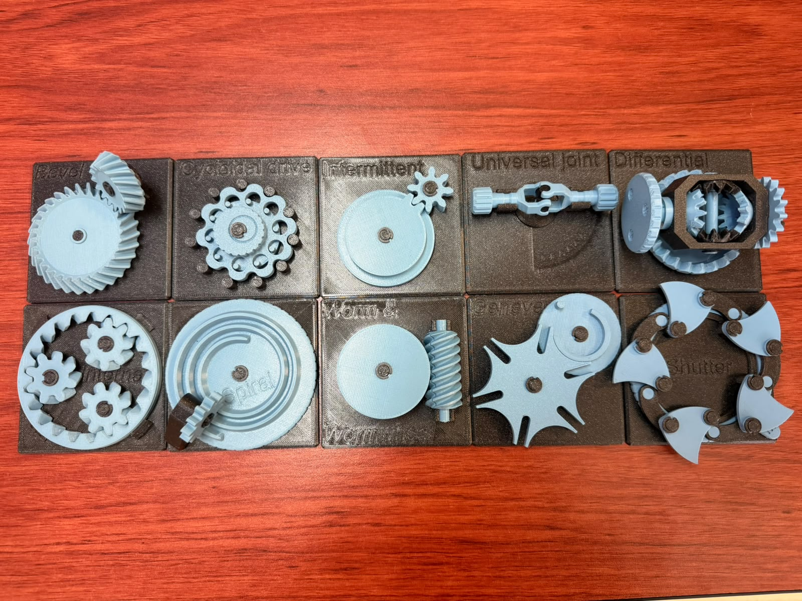

# Mecanismos 
## Conociendo los conceptos basicos de los mecanismos
### Palanca
Las palancas son la maquina mas vieja y sirven para transmitir fuerza y desplazamiento. Su formula es la siguiente:

$$
\boxed{F_1 \cdot D_1 = F_2 \cdot D_2}
$$

en donde: 
- $F_1$ = fuerza aplicada en el primer lado
- $D_1$ = Distancia desde el punto de apoyo hasta donde se aplica $F_1$

- $F_2$ = Fuerza aplicada en el segundo lado
- $D_2$ = Distancia desde el punto de apoyo hasta donde se aplica $F_2$

**Por ejemplo** 
$$
\boxed{10N \cdot 2M = 20N \cdot 1M}
$$
En ambos lados se produce la misma fuerza de 20N.

## Biela-Manivela
La principal caracteristica de este mecanismo es que convierte el movimiento lineal en rotatorio. Se forma por tres partes las cuales son :
- Manivela : Brazo que gira alrededor de un eje fijo. 
- Biela : Es una barra rigida que une tanto la manivela como el piston.
- Piston : Se desliza de forma recta dentro de un piston.  

El mecanismo sirve cuando el piston empuja lo cual hace que la biela esa fuerza de manera lineal hacia la manivela que gira.

## Relacion de transmisión
La siguiente formula es importante para el tema de **engranes** el cual es la siguiente:

$i = \frac{Z_2}{Z_1}= \frac{W entrada}{Wsalida} = \frac{T salida}{T entrada}$

En donde :
- i > 1: reducción : Menos velocidad pero mas par
- i < 1: multiplicación : Mas velocidad pero menos par
La relacion de transmision es clave en caja de cambios , diferencial y todo aquello que tenga engranes.

A continuacion se muestran los tipos de engranes

El cual se reparten en los diferentes tipos de engranes :

| Estacion  | ¿Que transforma? | Relacion estimada |Reversible o autobloqueante| Donde lo has visto en la vida real?   |¿Dónde serviría en el carro o en un proyecto tuyo?|
|-----------:|:----- |-------:|:---------:|-------:|----|
| Sensor X   | 2     | I2C    |           |        |    |
| MCU Y      | 1     | WiFi/BL|           |        |    |
|            |       |        |           |        |    |